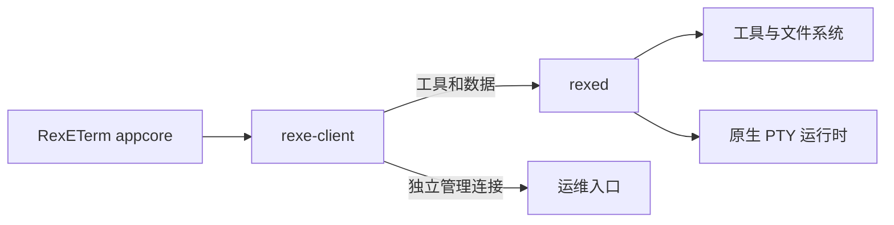

# RemoteExecutor 设计

## 范围

RE 提供工具执行、PTY、文件传输、流转发与只读运维。rexed 是执行端，rexe-client 承接 RE 能力。
应用实例和用户偏好属于独立 RexETerm。当前协议和命令执行行为沿用已有实现，本次分离应用层所有权。

## 架构

protocol 定义契约，transport 只处理不透明帧与链路，data 解释文件/通用流，client 和 server 分别组织两端。
终端运行时持有进程、PTY 和有界实时输出订阅，不保存历史或解析屏幕，也不依赖网络协议。
文件和流使用同一业务链路，没有 HTTP 文件旁路。

## 协作与状态

rexe-client 持有节点、会话、通道和本地转发；rexed 持有实际程序、文件操作与全局会话登记。
正式 rexed 使用 TLS 和密码/指定证书/CA 认证，用户权限见[认证指南](authentication.md)。
RE 用户不切换 OS 账号，SSH 尚未实现。
RexETerm appcore 保存客户端偏好、准备调用，并由 MCP、CLI、完整用户程序复用；详细设计在相邻项目维护。

## 相关文档

- [模块边界](module-boundaries.md)
- [客户端 SDK](modules/client.md)
- [RexETerm 设计](../../RexETerm/docs/design.md)
- [文档索引](README.md)
