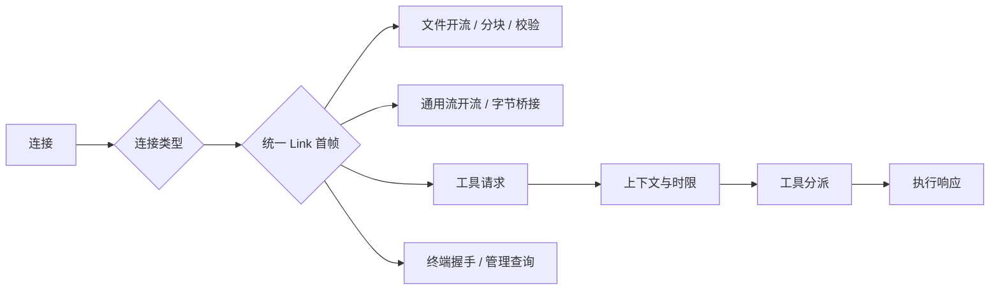

# Executor：节点执行与共享入口

## 范围

Executor 在目标机器接收工具请求，建立执行上下文并分派工具，同时让工具调用、终端访问和文件传输共用一个监听入口。

## 内部结构

### 节点身份响应

提供协议、版本、系统、标签与能力。

输入与输出：`_executor_info` → 身份结果。

实现位置：[executor/mod.rs](../../crates/server/src/executor/mod.rs)：`executor_info_result`。

### 请求上下文

选定工作目录、配置及 ShellManager。

输入与输出：请求 → `ToolContext`。

实现位置：`Executor::handle`。

### 启动默认值

持有启动时读取的不可变设置，供独立交互终端和未携带客户端规格的直接 shell 调用使用。
客户端规格只在执行器环境解析候选程序，不读取请求目录的配置文件。

实现位置：[settings/store.rs](../../crates/server/src/settings/store.rs)。

### 写操作互斥

约束文件修改与 文件上传。

输入与输出：写请求 → 持锁执行。

实现位置：`Executor::handle`。

### 时限策略

普通工具使用外层时限，命令与搜索进入各自时限路径。

输入与输出：工具及参数 → 调度策略。

实现位置：[executor/dispatch.rs](../../crates/server/src/executor/dispatch.rs)：`dispatch_with_timeout`。

### 工具分派

将工具名称和 JSON 参数转换为具体工具调用。

输入与输出：请求 → `ToolResult`。

实现位置：`dispatch_tool`。

### 共享连接分类

监听器只建立链路。数据层先处理可选的 RE 会话打开 / 绑定 / 心跳 / 关闭，再按业务首帧区分工具、终端、文件与流转发。

输入与输出：已建立链路 → 对应处理链。

实现位置：[listeners.rs](../../crates/server/src/executor/listeners.rs)、[data.rs](../../crates/server/src/executor/data.rs)：`serve_executor_link`。

### 通用流目标

识别开流握手，取得共享 stream slot，交给 `StreamOpener` 打开目标并进行双向桥接。
默认支持 TCP 与 Unix；32 个活动流名额独立于文件写锁。嵌入者可以替换 opener 接入设备。

实现位置：[data crate](../../crates/data/src/lib.rs)，详见[通用流与端口转发](forwarding.md)。

### 工具响应发送

反序列化请求并将结果写回当前链路。

输入与输出：请求文本 → 响应文本。

实现位置：`send_executor_response`。

### 文件数据适配

处理 FileRequest 的路径、偏移和长度。上传取得共享写锁，暂存数据，校验字节数与 SHA-256 后提交；下载发送分块和完成摘要。
每个 Executor 有独立于流转发的 32 个文件名额。

输入与输出：文件控制帧 / Binary → 文件及传输结果，不解析 HTTP。

实现位置：[file_transfer.rs](../../crates/server/src/file_transfer.rs)：`serve_file_transfer`，详见[统一文件传输](file-transfer.md)。

## 状态归属

Executor 持有节点身份、不可变启动设置、可选 ShellManager 、写锁、流目标 opener 、32 个共享流名额及 32 个文件名额。每个请求单独创建上下文；进程与终端的长期状态由 ShellManager 和 RE 原生终端运行时持有。

文件上传和工具写入共享同一个 Executor 写锁。上传先写临时文件，在长度和可选 SHA-256 校验成功后重命名到目标位置。

## 请求处理链

终端连接转交给 `terminal.rs`。RE 的终端管理查询只开放列表与详情；终端输入、窗口变化及控制请求另走终端消息处理链。

## 实现布局

`executor/mod.rs` 负责节点 API、上下文与写入门控；`dispatch.rs` 负责参数解码和执行时限；`listeners.rs` 负责物理监听，`data.rs` 负责数据分类和响应。文件数据适配位于 `file_transfer.rs`。

监听适配器只调用 `Executor::handle`，不直接分派工具；调度模块不持有监听器。Executor 克隆共享写锁和不可变设置；偏好管理工具由 Client 处理。

## 会话、独立管理与服务端事件

Executor 克隆共享 Registry，登记 RE 用户会话、已绑定链路计数和活动 PTY / 文件 / 转发通道。
单次工具上下文可带会话归属，程序创建者与当前 PTY 控制者由 ShellManager 分别维护。

独立 `rexed` 使用 `--admin-listen` 创建只读管理入口，默认 Unix socket；业务协议不会被管理入口处理。
运维快照提供客户端、程序、PTY、文件、转发五个页面的数据。
`events.rs` 统一输出会话、请求开始、程序、通道、文件与主控事件头，独立服务端默认写 stdout。
嵌入库默认关闭事件输出，不干扰业务客户端协议。详见[会话与运维](management.md)。

## 相关文档

- [文档索引](../README.md)
- [设计总览](../design.md)
- [文档规范](../documentation-guide.md)
