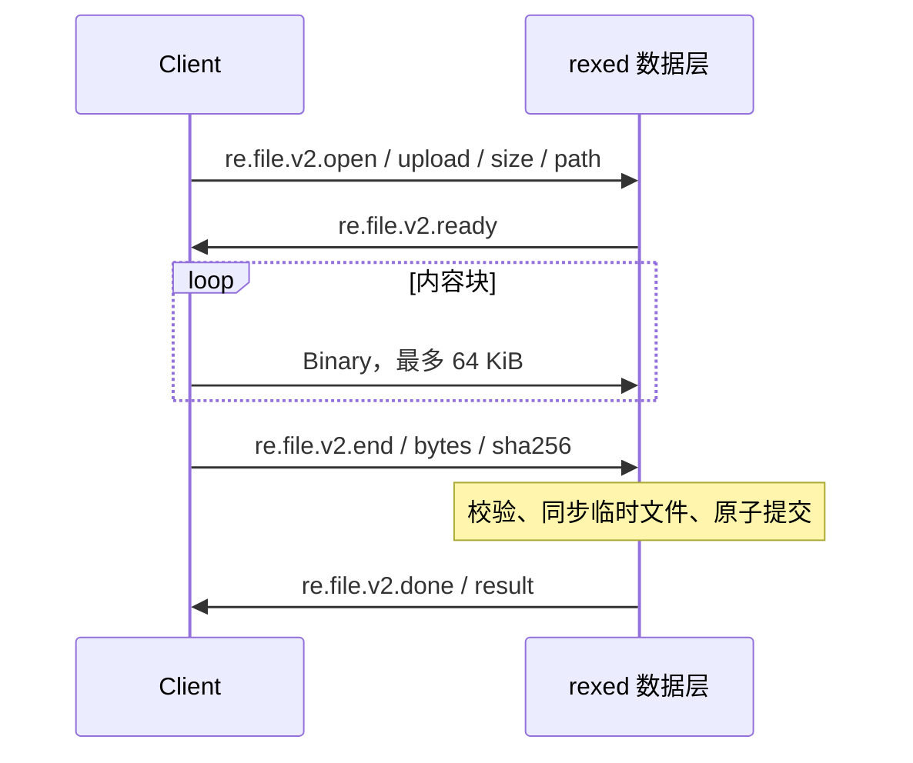

# 统一文件传输

## 范围

上传、下载与工具、终端、流转发共用 transport 的 `Link` 抽象。文件语义只在数据层解释。
WS 的 HTTP 握手只负责建立链路；服务端不再提供 GET / PUT 文件路由，也不派生独立的文件 URL。
TCP、Unix、可选 KCP 和注入的可靠设备流使用同一文件协议。

本模块提供单文件传输、下载偏移、长度与 SHA-256 校验、进度观察及取消清理。
尚未实现单文件跨链路分片聚合、上传续传或标准 SFTP subsystem。

## 模块职责

| 位置 | 输入与输出 | 状态与边界 |
| --- | --- | --- |
| [protocol/file.rs](../../crates/protocol/src/file.rs) | FileRequest / FileMessage / FileTransferResult | 线上类型，不依赖运行时 |
| [data/file.rs](../../crates/data/src/file.rs) | 文件控制帧、内容帧 ↔ AsyncRead / AsyncWrite | 分块、长度与散列校验、背压、进度；无地址或 HTTP |
| [data/staged_file.rs](../../crates/data/src/staged_file.rs) | 目标路径 → 临时文件 → 已提交文件 | 同目录临时文件与原子替换；取消时自动清理 |
| [client/transfer.rs](../../crates/client/src/transfer.rs) | 本地文件与远端目标 → 传输结果 | 选择 File 通道并持有租约，使用注入的 Connector |
| [server/file_transfer.rs](../../crates/server/src/file_transfer.rs) | 开流请求 → 远端文件与结果 | 解析远端路径、共享写锁、文件身份元数据 |
| [server/executor/data.rs](../../crates/server/src/executor/data.rs) | 已建立 Link 的首帧 → 数据处理器 | 文件、工具、终端、流转发统一分派 |

## 工具入口

stdio / MCP 的 `file_transfer` 现在实际传输文件，完成校验和提交后才返回成功；不再只返回 HTTP 请求描述。

```json
{
  "id": "upload-1",
  "tool": "file_transfer",
  "executor": "box",
  "params": {
    "mode": "upload",
    "localPath": "./artifact.bin",
    "targetPath": "/tmp/artifact.bin",
    "overwrite": false
  }
}
```

下载使用 `mode: "download"`，方向为远端 `targetPath` 到客户端 `localPath`。
原始 stdio 使用顶层 `executor` / `directory`；MCP 在 arguments 内使用 `targetExecutor` / `directory`。
`directory` 只作为远端相对路径基准，本地相对路径由客户端进程工作目录解析。
两个方向的目标父目录都须存在，不自动创建目录。

`overwrite` 默认 false，约束上传的远端目标或下载的本地目标。
下载可设置非负 `offset`，从远端该字节开始传输；本地得到该段内容，不追加已有文件。
上传不接受非零 offset。`sha256` 可为上传提供预期的 `sha256:...` 散列；无论是否提供，两个方向都校验传输内容的完整散列。

成功 metadata 包含 `protocol: "re.file.v2"`、mode、两端路径、bytes、sha256 和远端 file 身份元数据。
无 url、method、headers 或 fileTransferPath。

## 库接口

`Client::transfer_file(executor, options, directory, observer).await` 返回 `FileTransferResult`。
`FileTransferOptions` / `FileTransferMode` 从 client 导出；`TransferObserver` 从 `client::data::file` 导出。

观察器收到当前方向已传输的绝对 bytes 和 total，适合宿主维护任务状态、进度和速度。返回错误可取消传输。
宿主也可以直接丢弃 future 或中止所属任务；RE 本身不规定会话 ID、任务列表或持久化方式。
旧 REFS 独立项目已移除，文件能力通过 RE SDK 和统一数据通道接入。

## 数据协议

端点声明 `fileTransfer: true` 与 `fileTransferProtocol: "re.file.v2"`。
客户端核对能力后使用 `Purpose::File` 获取链路；旧节点缺少该协议时返回升级错误，没有 HTTP 回退。

### 上传



上传先取得与 FileAction 共用的 Executor 写锁。接收大小、End 大小和散列全部匹配，可选预期散列也匹配后才提交。
目标存在且不允许覆盖时拒绝；目标在传输期间被其他写入者创建时，禁止覆盖的提交仍会失败并保留该目标。

### 下载

服务端 Ready 给出传输字节数与 offset，随后发送 Binary、End 和 Done。
客户端核对 Ready、End、实际字节和 Done 散列一致后，再提交本地临时文件。
下载 offset 非零时，bytes 和 sha256 对应该段传输内容，file 元数据仍描述完整远端文件。
文件未提供快照隔离；并发修改或替换源文件时，不保证内容属于单一时刻的快照。

### 背压、容量与时限

每次发送和目标写入都等待下游接受，内存不会随文件大小增长；客户端分块发送，单文件可大于 16 MiB 的 Link 帧上限。
文件通道默认并发 4，独立于 Control / Query / PTY / Forward 限额。
服务端最多 32 个活动文件传输，和流转发的 32 个名额分开；满额立即返回错误。
上传共享写锁，下载与查询不取写锁；物理链路带宽仍共享，不能据此承诺延迟。

客户端申请 File 通道最长 30 秒；每次帧收发空闲等待最长 30 秒；服务端等待上传写锁最长 30 秒。
传输没有固定总时长。超时、断链、错误消息或无效分块均终止传输。

## 提交与取消

临时文件在目标同目录创建；丢弃传输 future 会释放本地临时文件，远端观察到关闭或空闲超时后清理上传临时文件。
已有目标在最终校验和同步成功前保持原内容，不先删除目标。
最终替换在一个短的阻塞任务中完成；取消与提交同时发生，或提交后响应丢失时，目标可能已经成功替换，不能将客户端超时解释为服务端回滚。

SHA-256 提供传输完整性检查；链路认证、加密和身份绑定仍由安全传输实现负责，当前 KCP 不提供这些能力。

## 验证

- [file_transfer.rs](../../../RexETerm/tests/file_transfer.rs)：WS / TCP / Unix / KCP / 注入设备流，17 MiB 文件、空文件、下载偏移、File 用途选择、进度与查询并发。
- 同文件验证取消、截断、错误散列、覆盖拒绝及原文件保留；直接 HTTP GET / PUT 不再读写文件。
- [module_boundaries.rs](../../../RexETerm/tests/module_boundaries.rs)：上传与工具写入共锁，查询仍可执行。
- [remote_only.rs](../../../RexETerm/tests/remote_only.rs)：旧 HTTP 能力节点明确报升级错误。
- [MCP 测试](../../../RexETerm/tests/mcp_test.rs) 与 [stdio 测试](../../../RexETerm/tests/file_transfer.rs)：返回成功前实际文件已完成。
- [staged_file.rs](../../crates/data/src/staged_file.rs)：禁止覆盖时保留并发创建的目标。

## 相关文档

- [传输层与数据层](transport.md)
- [文件与搜索](files.md)
- [构建与 API 迁移](../build-and-api.md)
- [文档索引](../README.md)
