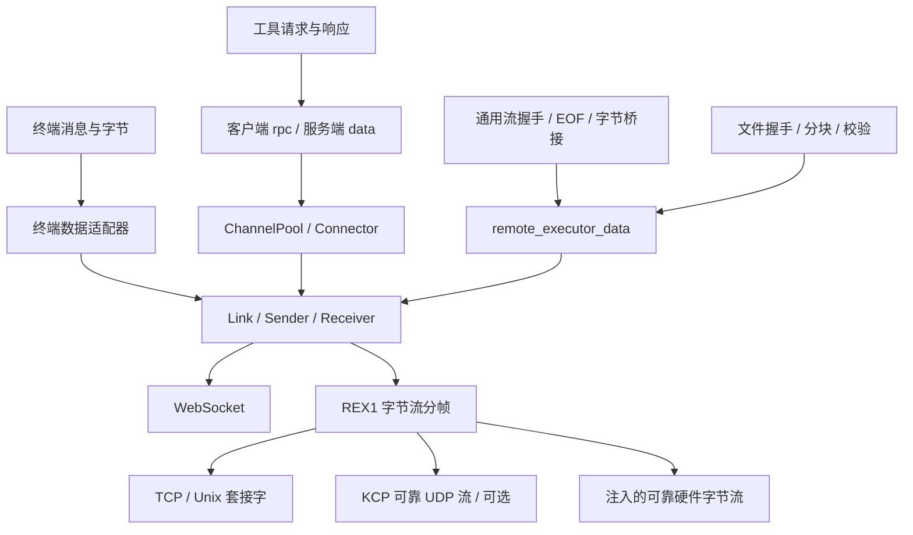

# 传输层与数据层

## 范围

`remote_executor_transport` 将不透明帧封装到目标链路，管理连接容量。数据层解释工具、终端、文件与转发语义。
传输层不解析业务 JSON、不选择执行器、不执行工具。服务端程序名为 `rexed`。

## 分层关系



链路承载方式与被转发的目标是两个独立选择。例如 Client 通过 KCP 连接 rexed，再由 rexed 连接 TCP 服务。
KCP 使用 UDP 承载可靠有序字节流，不表示已经实现 UDP 数据报端口转发。

## 传输模块

### 帧与连接

`Frame` 表达文本、二进制和关闭。`Link` 可拆为发送端和接收端，支持双向并发。
`halves()` 可借用两个方向，让调用方在保留连接及会话租约的同时独立驱动收发。
传输保留消息边界、识别关闭并报告错误。单帧上限 16 MiB，更大数据由上层分块；文件数据层按 64 KiB 分块。

接收取消后可继续读取。发送中途取消后应丢弃链接，业务请求不自动重放。
`Sender` 在运行中的 Tokio runtime 内析构时，最多用 1 秒尝试发送关闭帧；这是有界清理，不保证断网或残缺帧后的远端即时释放。

实现位置：[lib.rs](../../crates/transport/src/lib.rs)。

### 连接适配

`Connector::connect` 建立链路；`connect_for` 可按用途调节链路参数。
默认实现支持 `ws://`、`tcp://`、Unix 上的 `unix://`，启用 feature 后支持 `kcp://`。
Client 把无协议前缀的地址解释为 WS。其他地址原样交给注入的 Connector。
默认 TCP / WS Connector 和业务 TCP / WS 监听对底层 TCP 开启 NODELAY，避免小控制消息或 REX1 头部被 Nagle 等待。

`with_connector(Arc<dyn Connector>)` 注入自定义实现；`from_stream` 接收已配置好的 `AsyncRead + AsyncWrite + Unpin + Send`。
消息型设备也可以直接实现 `FrameReader` / `FrameWriter`。打开设备、波特率、物理流控和认证由具体适配器处理。
服务端通过 `serve_executor_link` 接入已建立链路。当前没有内置串口驱动或实物硬件验证。

实现位置：[connector.rs](../../crates/transport/src/connector.rs)。

### WS 与可靠字节流

WS 的文本、二进制映射到对应消息；Ping/Pong 与关闭在适配器内处理。
既有 `ptyt` / `ptyc` 终端消息仍兼容。

TCP、Unix、KCP 及注入的可靠有序流使用 REX1：

| 字段 | 长度 | 内容 |
| --- | --- | --- |
| magic/version | 4 字节 | ASCII `REX1` |
| kind | 1 字节 | 1：UTF-8 文本；2：二进制；3：关闭 |
| length | 4 字节 | 大端无符号长度；关闭必须为 0 |
| payload | length 字节 | 不透明数据 |

非法 magic、类型、长度、UTF-8 或截断被报告为错误。接收器保留部分帧状态。
发送器只在整帧已写入后允许析构清理追加关闭帧，半帧写入取消会使发送器失效。

实现位置：[websocket.rs](../../crates/transport/src/websocket.rs)、[stream.rs](../../crates/transport/src/stream.rs)。

## TLS

[tls.rs](../../crates/transport/src/tls.rs) 在可靠字节流上提供 rustls TLS，支持 `tls://` 与 `wss://`。
连接携带加密标志和对端证书；认证层在业务握手前验证 RE 用户。
I/O 计数位于 TLS 之下，包含加密记录的实际链路字节。
服务端证书、客户端 pin/CA 和权限配置见[认证指南](../authentication.md)。

## 多链路与通道

### 用途与容量

每个端点拥有 `ChannelPool`。`Purpose` 区分五类用途，各类并发限额独立，取值为 1～1024：

| 用途 | 默认限额 | 当前使用方 |
| --- | --- | --- |
| control | 2 | 控制、文件修改、Exbash stop / remove / list |
| query | 4 | read / stat / glob / rg |
| pty | 4 | Exbash 启动与 attach |
| file | 4 | 上传 / 下载，包含握手、字节与完成校验 |
| forward | 8 | 每个被转发的流 |

这是动态建立独立连接的调度器。连接使用期间必须持有 `ChannelLease`，拆分 Link 后也一样；租约释放时归还用途和物理链路容量。
默认网络 Connector 每个目标允许 32 条连接；自定义 Connector 保守默认为 1，可通过 `max_parallel_links` 声明实际容量。
单串口不因配置多个用途而自动变成多个物理链路；复用需要适配器提供相应能力。

各类限额避免某一种用途占满自己的通道。物理链路容量仍共享，没有严格优先级、带宽预留或延迟保证。
文件字节已接入 file 限额；直接终端客户端不经过 Client 的调度器。

### 多个目标链路

`connect_to_executor` 的 `url` 是主链路，`links` 为额外链路。接入前分别探测并核对节点 ID、系统信息及 shell / stream 能力。
元数据一致性检查独立于身份认证；正式 rexed 的各链路还须通过 TLS 与账号认证。

```json
{
  "id": "connect-1",
  "tool": "connect_to_executor",
  "params": {
    "id": "box",
    "url": "tcp://host:9002",
    "links": ["ws://host:9001", "kcp://host:9003"],
    "channels": {"control": 2, "query": 4, "pty": 4, "file": 4, "forward": 8}
  }
}
```

这些地址必须由同一个 Executor 实例提供。嵌入者可用同一 Executor 和 ShellManager 克隆调用多次监听 API；CLI 当前只接受一个 `--listen`。
调度器轮转选择有空位的目标。只有连接建立失败时尝试其他目标，发送过的请求不自动重试。
单条字节流始终固定在一条链路，保持顺序；多个流可分散到不同链路并行运行。
当前没有空闲连接复用、单流分片聚合、链路权重或单文件并行传输。
Tokio runtime 调度并发任务，实际吞吐取决于链路、CPU 和远端目标。

实现位置：[pool.rs](../../crates/transport/src/pool.rs)、[endpoint.rs](../../crates/client/src/endpoint.rs)、[rpc.rs](../../crates/client/src/rpc.rs)。

## KCP 实验后端

`kcp` feature 默认关闭，使用 `tokio_kcp`。客户端与服务端都需要启用：

```bash
cargo build -p remote_executor --no-default-features --features server,kcp --bin rexed
cargo build -p remote_executor --no-default-features --features stdio,mcp,kcp --bins
rexed --id node --listen kcp://127.0.0.1:9003
```

开启 stream 模式并保留拥塞控制。Control / PTY 连接使用 10 ms 更新和快速重传；其他用途使用普通参数。
服务端接收端使用交互参数，尚无服务端用途协商。每次帧 flush 等待已发送数据全部 ACK，最长 30 秒，避免底层析构停止重传而丢失末帧。
这是保守的完整性策略，可能增加 RTT 对吞吐的影响；尚未完成真实公网、带宽、乱序和拥塞对比，不能据此认定优于 TCP。

KCP 当前不提供加密，启用认证的 Executor 拒绝该监听；TLS/WSS 的安全会话已实现。
SSH wire protocol 尚未实现，现有端点 ID 不能作为认证凭据。

实现位置：[kcp.rs](../../crates/transport/src/kcp.rs)。

## 数据模块

| 模块 | 输入与输出 | 职责边界 |
| --- | --- | --- |
| 客户端 rpc / 服务端 executor data | 工具请求 → 响应 | JSON 解释、调用预算、首帧分类 |
| 服务端 terminal | 终端消息 ↔ 内部事件与 PTY 字节 | 不创建物理连接 |
| `remote_executor_data` | 流 / 文件数据 ↔ ByteStream 或文件 | 流握手、文件分块、散列、暂存与背压；不依赖两端角色 / PTY |
| 服务端 file_transfer | FileRequest ↔ 文件内容与结果 | 上传校验、原子替换及共享写锁 |

转发接口与生命周期见[通用流与端口转发](forwarding.md)。
文件帧和字节共用端点连接与 File 调度；所有链路声明 `re.file.v2`，没有 GET / PUT 文件路由。详见[统一文件传输](file-transfer.md)。

## 启动入口

```bash
rexed --insecure-no-auth --id node --listen ws://127.0.0.1:9001
rexed --insecure-no-auth --id node --listen tcp://127.0.0.1:9002
rexed --insecure-no-auth --id node --listen unix:///tmp/rexed.sock
```

异步 `start_executor(...).await` 支持所有启用的内置后端；同步 `start_executor_listener` 保留 WebSocket、TCP、Unix 接口。
`start_shared_executor_ws` 保留旧的 host:port 返回值。Unix 绑定失败不删除已有路径。
Windows 命名管道可注入适配器，目前没有内置监听器。

## 验证

- [传输测试](../../crates/transport/src/test.rs)：分帧、分片、取消、非法输入、关闭、WS 控制消息。
- [通道测试](../../crates/transport/src/pool_test.rs)：用途隔离、取消释放容量、租约唤醒。
- [KCP 测试](../../crates/transport/src/kcp_test.rs)：回环代理每 13 个 UDP 包丢弃 1 个，双向各 128 KiB 内容完整性。
- [传输集成](../../../rexeterm/tests/transports.rs)：WS / TCP / Unix / 自定义流共用工具和终端处理。
- [转发集成](../../../rexeterm/tests/forwarding.rs)：多链路、TCP / WS / KCP 并发转发、半关闭及停止清理。

## 链路 I/O 计数

[traffic.rs](../../crates/transport/src/traffic.rs) 用 `CountedIo` 在实际读写处统计字节。
`from_stream` 和服务端 WS accept 自动带计数器，后者从 HTTP 握手之前开始统计。
`TrafficMeter` 属于单链路，`TrafficAggregate` 合计已经归属的链路；它们不解析用户或数据类型。
服务端 Registry 将计数器绑定到 RE 客户端，`rexctl` 直接显示全部已绑定业务链路的 RX / TX / TOTAL MB/s。

自定义帧适配器用 `Link::with_traffic` 注入封装下方的计数器；缺失时运维标记统计不完整。
100 ms 桶构成最近约 1 秒的速率窗口；累计字节在链接关闭后保留。
统计包含适配器可见的封装，排除 TCP/IP 与物理开销；KCP 当前不计内部 UDP 重传和 ACK。
完整边界与独立管理入口见[会话与运维](management.md)。

## 相关文档

- [模块边界](../module-boundaries.md)
- [构建与 API 迁移](../build-and-api.md)
- [文档索引](../README.md)
