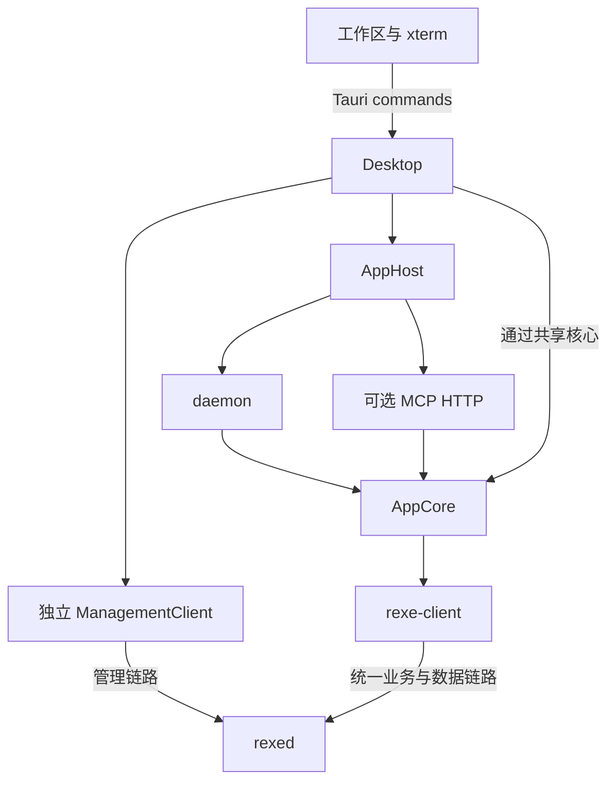

# RexETerm App 设计

## 范围与状态

当前实现 Windows Tauri 工作区预览，使用真实 RE 业务接口。
后台为同一进程内的 Desktop、AppHost、daemon 和 AppCore，MCP HTTP 是可选入口。

## 架构

共享 Application 拥有保存的 Host、文件传输任务和一个活动 PTY 预览，Desktop 负责 GUI 组合，AppCore 拥有连接和客户端偏好，
SDK 拥有实际通道、会话与本地转发监听器。前端只保存选择、导航、表单和展示状态。
静态资源直接嵌入 Tauri，不需要 Node 开发服务器或额外 HTTP 文件端口。

## 工作区

左栏有总览、Host、文件夹和运维四个入口。总览汇集此 App 的已连接执行器、活动 PTY、
文件任务和转发，支持跳回对应操作视图；文件树惰性展开，下面显示选中项目的属性。
中心有文件浏览标签和预览标签。文件预览限制为 2 MiB 内前 300 行，二进制显示前 128 字节；
任务预览使用原始 PTY 流和 xterm，支持输入、缩放、主控状态和显式申请主控。
底栏任务列表由 rexed 按当前持久 clientId 返回 exbash 记录，文件任务及转发属于此 App，通过当前 Host 筛选。

workspace.json 保存 Host ID 索引与最后选择；Host 配置、用户认证/密钥与偏好按执行器分目录。
私有恢复凭据由 AppCore 保存在执行器目录的 identities.json，重连后由服务端重建归属列表。
运行状态、通道、传输历史及布局不写入工作区配置；任务最终元数据单独存入 AppCore 历史文件。

## 生命周期

关闭或切换 PTY 预览会取消流泵并释放 TerminalConnection，不停止远端程序。
PTY 输入队列和输出队列有界，输出通过小批量二进制 IPC 拉取交给 xterm，写入完成后再拉取下一批。
独立 terminal_poll 命令使用 Tauri 原始响应交付 ArrayBuffer，原始 PTY 字节不进入 JSON 数字数组；
控制和状态元数据继续使用 JSON。批次格式与关闭顺序见[后端模块](modules/backend.md)。
输入、缩放和关闭都携带预览 ID，防止旧界面操作影响新终端。

文件任务可取消，最多并行 8 项，最多保留 200 项完成历史；进度来自 TransferObserver。
MCP HTTP 的启停保留 RE 连接、偏好、转发和 UI 状态。
应用最终退出禁止新任务，关闭 PTY，取消并等待文件传输，再等待 AppHost::shutdown；显式退出立即结束服务端运行资源，失联则等待默认 60 秒的服务端宽限期。

## 运维连接

Desktop 为 Host 单独维护 ManagementClient，不改变业务默认执行器，不登记业务会话。
管理地址显式设置优先，缺省仅对网络地址尝试端口 + 1；Unix socket 必须显式设置本机可访问路径。
运维 profile 缺省继承业务认证，也可使用独立管理员 profile；凭据及引用密钥导入该执行器的 management 子目录。
切换配置后丢弃旧连接；同一 Host 串行读取，失败和取消都丢弃连接，缓存最多 16 个 Host，退出全部释放。

五个只读页面展示客户端、任务、PTY、文件和转发快照。成功后每约 1.8 秒刷新；失败停止自动重试，等待手动刷新。
切换 Host 的旧请求不覆盖新界面，失败不保留旧全局数据；权限由独立管理端认证和 management 权限决定。

## 后续范围

多窗口、多终端标签、连接健康事件、单节点断开/更新、传输阶段模型与安装包还需后续实现。
RE 的密码/证书/CA 认证已接入 Host 的私有连接配置；SSH 和系统用户切换尚未实现。

总览只显示活跃项；完成、取消、失败的文件任务及已退出的 PTY 从总览隐藏，底栏保留本实例的历史。

## 相关文档

- [运行指南](getting-started.md)
- [后端模块](modules/backend.md)
- [前端模块](modules/frontend.md)
