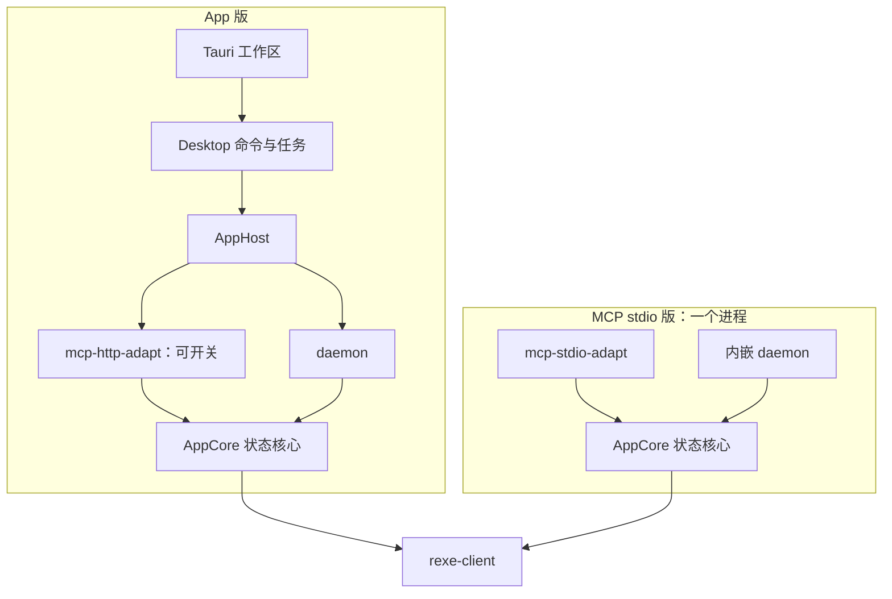

# RexETerm 设计

## 范围

入口包含 App、MCP stdio 和普通 HTTP 宿主。App 版包含完整界面，可在运行时开关 MCP HTTP；
stdio 版只提供普通 MCP，daemon 融合在同一进程。当前已实现 Windows Tauri 工作区预览。

## 架构

AppCore 持有 Client 和偏好，运行事实由 SDK 统一维护；daemon 负责启动与生命周期，不再复制业务状态。
协议适配器只处理输入输出及协议状态，不启动 daemon，不生成第二套路由或偏好。
AppHost 组合 daemon 和可选 HTTP。桌面命令访问同一个状态核心，MCP HTTP 是对该 App 状态的另一入口。

## 状态与生命周期

AppCore 克隆共享 Client、连接、通道和偏好；独立核心互不共享。HTTP 协议会话的 ID、版本、取消和租约各自独立，
但连接、默认节点及偏好属于 App，所有 HTTP 会话共同使用。HTTP 会话不等于独立 RE 用户或 RE 会话。
不同 App 或 stdio 进程各有自身核心，需要隔离身份时创建不同核心。

AppHost 的 HTTP 默认关闭。enable_mcp_http 创建监听；disable_mcp_http 停止监听并取消 HTTP 在途请求，
保留 AppCore、RE 连接、转发和偏好。重新开启分配新的 MCP 会话。开关操作与应用退出串行化。
最终退出先停止 HTTP 和界面新工作，再取消/等待在途操作并 shutdown 核心；显式关闭 RE 会话回收远端资源。
stdio EOF 等待该进程内请求结束，再由内嵌 daemon 关闭核心。适配器本身不关闭宿主提供的核心。

## 协作边界

AppCore 无本地执行器、监听、stdio 或 Tauri 依赖；daemon 的 local feature 才引入本地执行环境。
两个 MCP 适配器是独立 Cargo 包，可分别编译。stdio 产品的默认依赖不含 HTTP 和 AppHost。
App 库默认具备 HTTP 模块，但监听仍需显式开启；禁用其 mcp-http feature 可去掉 HTTP 依赖。
SDK 提供按节点断开；共享 Application 提供 Host 和文件任务，适配器不重复实现。
Tauri command 连接 WebView 与进程内 Desktop；CLI 通过同一二进制的 daemon 模式创建和启停用户态宿主，使用原生 Unix socket / Windows 命名管道，按 cwd 的 `.rexeterm/binding` 或显式 UUID64 选择宿主；程序旁 `.rexeterm-socket/` 只维护映射、私有 token 与 IPC 定位记录。ID 保留到系统重启，GUI/MCP 不使用此目录绑定。系统服务安装仍未实现。
桌面包含 Host、文件树与属性、中心文件/任务 PTY 预览，以及任务、传输和转发三个底栏。

普通 HTTP 宿主和 GUI 复用 `crates/application` 的工作区与应用服务。
任务历史由 AppCore 保存，完成任务的原生 PTY 在 RE 释放，见[生命周期说明](../../rexed/docs/lifecycle.md)。

## 相关文档

- [状态核心](modules/appcore.md)
- [daemon](modules/daemon.md)
- [MCP 适配](modules/mcp.md)
- [完整 App](../app/docs/design.md)
- [文档索引](README.md)
